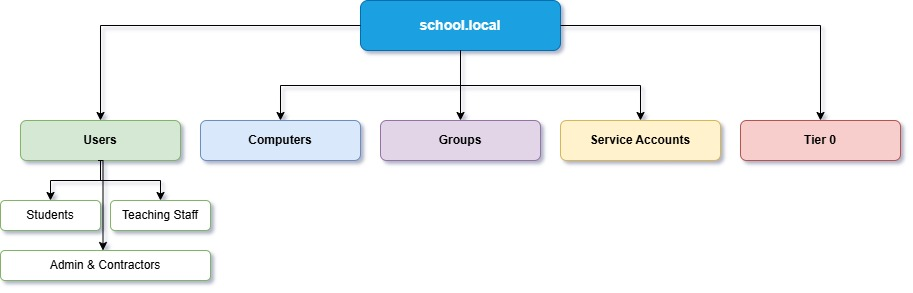

# Windows AD Security Lab

A lab project demonstrating the design, implementation and defence of a Windows Active Directory environment. This lab simulates a realworld scenario and uses attack simulations to validate security. Goal of this project is to deepen my understanding of Windows Active Directory by using a hands on lab to simulate real AD use.

## ⚠️ Project Status ⚠️

> This project is currently in the Implementation phase. Deploying VMs.

- [x] **Phase 1: Scenario & Design** *(Complete)*
- [ ] **Phase 2: Lab Build** (Active Directory Workstations) *(In Progress)*
- [ ] **Phase 3: SIEM Deployment** (Wazuh)
- [ ] **Phase 4: Detection Engineering** 
- [ ] **Phase 5: Attack Simulation** 

## 📌 Project Overview 📌

**The Scenario:** A school with 1200 students and 150 staff requires a new security infrastructure. The environment requires strict control over access to sensitive data and requires full audit logging to satisfy legal and safeguarding requirements.

**The Goal:** Deepen my understanding of Windows Active Directory by designing a secure and appropriate architecture for the scenario. Deploying and using SIEM to capture Windows event logs. Simulating a cyberattack to prove environment can detect and neutralise malicious activity.

## 🏗️ Architecture and Design 🏗️

The environment is designed using a **Hybrid OU Structure**.

*For a deeper dive into the architecture and design read [AD Design Decisions Document](docs/Scenario-Design/design-decisions/AD%20Design%20Decisions%20Document.pdf)*

## 📚 Project Documentation 📚

I have documented the entire lifecycle and every step of this project. All the details as well as the thought processes behind every design decision can be found here:

*   📄 [**Project Scenario**](docs/Scenario-Design/scenario/Windows%20AD%20Project%20Scenario.pdf) - The problem, scope and success criteria.
*   📄 [**Active Directory Design Decisions**](docs/Scenario-Design/design-decisions/AD%20Design%20Decisions%20Document.pdf) - Each decision for the Domain Model, OU Structure, Admin Tiering, LAPS and GPO strategy design.
*   📄 [**SIEM Design**](docs/Scenario-Design/SIEM-design/SIEM%20Design%20Document.pdf) - The logging startegry, retention policy amd altergy philosophy for Wazuh.

## 🚀 Project Management 🚀

This project has a 12-week real life time deadline of 23/01/2027. Jira is used for all the tracking of the development lifecycle. Each stage of development has its own phase.

## 🛠️ Technology Stack 🛠️

*   **Virtualisation:** VirtualBox
*   **Identity & Access:** Windows Server
*   **SIEM / Monitoring:** Wazuh

## ⚠️ Disclaimer ⚠️

This project is strictly for educational and portfolio purposes. Attacks were carried out in closed and isolated virtual environments.