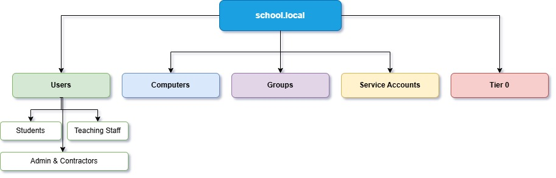

**AD Design Decisions**

This document will discuss various different design approaches and considerations giving reasoning as to why each decision was made.

# Domain Model

**Decision:** Single Forest/Single Domain Model

**Alternatives:** Multi Domain Model

**Reasoning:** When designing an Active Directory model, Microsoft’s learn guides outline two primary approaches: a single forest/single domain or a multi domain solution. Given the constraints and circumstances of this scenario a single domain model is deemed the more appropriate choice.

The first reason is the physical constraint. The school is a single site location. As multi domain designs are recommended for large geographical areas with separate IT teams this doesn’t apply.

The second reason is the skills and resource constraints. As this is a solo project the Active Directory is designed specifically to be managed by a single administrator. Multi domain solutions introduce a considerable administrative workload requiring additional Domain Controllers as well as more complex topologies.

By implementing a single domain a direct support is made to the first success criterion: providing a fully operational domain without unnecessary complexity.

Finally the domain will be  named  _school.local_. It will be a single namespace as there will be no need to separate identities.

# OU Structure

**Decision:** Hybrid OU Structure

**Alternatives:** Department Based Structure

**Reasoning:** There are various different approaches a person can make when designing an OU structure. Each individual aspect of the scenario has to be considered and taken into account. Examining the scenario raised a few key requirements: sorting data of students by year, separation by departments for staff and special access accounts for evidence access control.

By taking into account the highlighted key points two approaches were initially drafted and considered. First was a traditional department/role based structure and the second was an improved version of the first a hybrid of object types and role structures.

The benefits of a traditional department/role based structure hinged on its simplicity and ease of implementation. However when considering the future GPO strategy a department/role based structure will cause a lot of problems in the future due to having to apply security filtering on every single GPO which would be messy. Based on this assertion it was deemed a traditional department/role based structure would not be applicable in this scenario.

By using a hybrid structure instead the benefits of using a traditional department/role based structure can be maintained whilst directly addressing the drawbacks. Sorting the OU structure by top level object types and adding sub levels for roles/departments allows for a simple and easy to understand implementation that satisfies the key points outlined in the scenario. The drawbacks are negated as now security filtering doesn’t have to be applied to every single GPO instead through the use of hierarchical OU structure. This reduces the unnecessary policy duplication and removes the need for extensive security filtering.  

# Admin Tiering

**Decision:** Microsoft Tiered Administration Model

**Alternatives:** Flat Administrative Model

**Reasoning:** When designing access control for administrative accounts a common approach is to use a flat model where IT staff use a single domain admin account for all tasks. This approach would work however is a highly insecure practice. If a Domain Admin logs into an infected workstation their credentials would be exposed to malware and could potentially compromise the entire domain.

To avoid this possibility and provide more security a Tiering Administration model was chosen. This aligns with Microsoft’s best practices by separating administrative roles based on sensitivity of the systems they manage.

-   **Tier 0:** Includes Domain Controllers and domain admin accounts. These credentials will never be used to log into standard workstations.
    
-   **Tier 1:** Includes File Server. Admin accounts for this Tier manage servers but cannot touch Domain Controllers.
    
-   **Tier 2:** Includes student and staff workstations. Help desk staff will have Tier 2 accounts to manage workstations but no access over the servers or domain.
    

By implementing the Tiering Administration model one of the scenario’s requirements for access control is directly answered. If a student workstation is compromised during the attack simulation the attacker will only obtain a Tier 2 credential not allowing them access to the file server or Domain Controllers. To reinforce this security measure further a GPO will be used to block Tier 0 and 1 accounts to logging into Tier 2 machines.

# Delegation

**Decision:** Role Based Delegation

**Alternatives:** Domain Wide Admin Rights

**Reasoning:** Domain wide admin rights would be catastrophic for the security of the system. If every single IT person was a Domain Admin a single phishing email could compromise the entire school. To eliminate that risk rights will be delegated for roles instead.

By creating security groups for specific roles potential security dangers can be prevented. This will be achieved by restricting each account to the minimum amount of access to fulfil its responsibilities. An example of this could be a IT Help desk having the ability to only reset passwords and unlock accounts for students and teaching staff. A Help desk account will not be able to reset the password of an IT admin and they cannot modify Group Policy.

# Account Types

**Decision:** Separation of Accounts

**Alternatives:** Standard User Account

**Reasoning:** Every IT staff member will have two accounts. A standard account for checking emails and a privileged account for administrative tasks. This prevents a compromised standard account from having admin rights.

Non-human accounts for services such as monitoring software or SQL server will use gMSA (Group Managed Service Accounts) whenever possible. This is to avoid manually managing passwords instead using Window’s automatic password rotation. This encourages good password policy and protects from passwords becoming stale.

Contractor accounts used for catering and cleaning staff will have strict login hour restrictions with an account expiry date that automatically disables when their contract ends with access reviewed periodically.

This approach of account separation is a preventive as well as proactive security prevention method.

# GPO Strategy

**Decision:** Hierarchical GPO Application

**Alternatives:** Local Policies

**Reasoning:** Managing settings on potentially 100+ machines is unmanageable. However, using a single monolithic GPO for the entire domain is equally as flawed as it would force restrictions on everyone regardless of role. To balance security and manageability a hierarchical GPO strategy will be implemented. Each GPO policy can be split into three main categories:

-   **Domain Level:** A baseline GPO enforcing account policies such as password length and lockout thresholds. This GPO will audit policies across the entire school to ensure SIEM logging standardisation.
    
-   **OU Level:** Specific GPOs will be linked to role OUs. For example the students OU will receive a GPO that blocks Control Panel access and restricts command prompt usage.
    
-   **Enforced GPOs:** The Tier 0 OU will have enforced GPO to guarantee the Domain Controllers cannot be overridden by lower level OUs.
    

By apply GPOs in these three categories will provide simple and clean security settings without the need for complex filtering balancing the breadth and depth.

# LAPS

**Decision:** Windows LAPS

**Alternatives:** Common Local Admin Password

**Reasoning:** A dangerous practice is to use the same local administrator password across all workstations. This is a security risk as if a workstation is compromised and a shared local admin password is used an attacker could move laterally and gain higher access permissions by reusing passwords.  To mitigate this risk Windows LAPS will be implemented instead. LAPS generates complex and unique passwords for the local Administrator account on every single workstation. These passwords are stored securely and rotated automatically with the main benefits being  preventing higher access gain as well as password rotation.